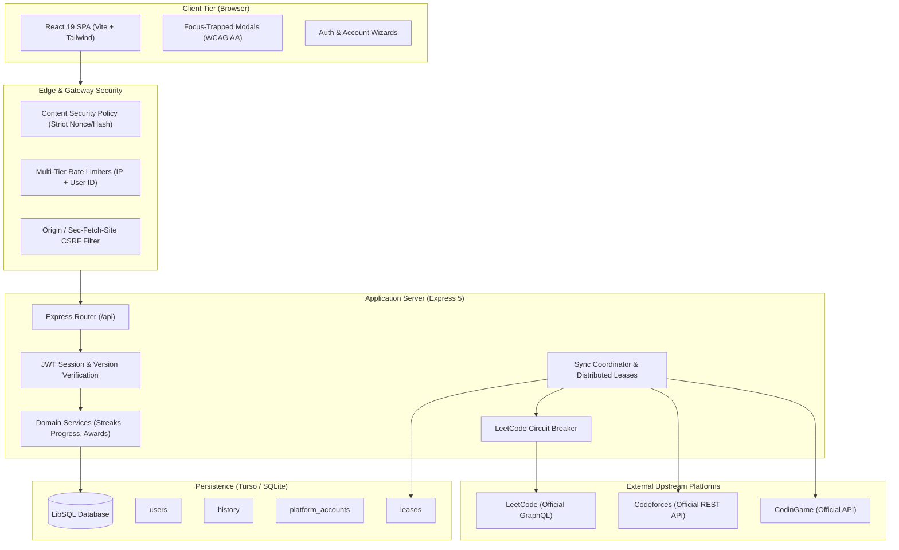
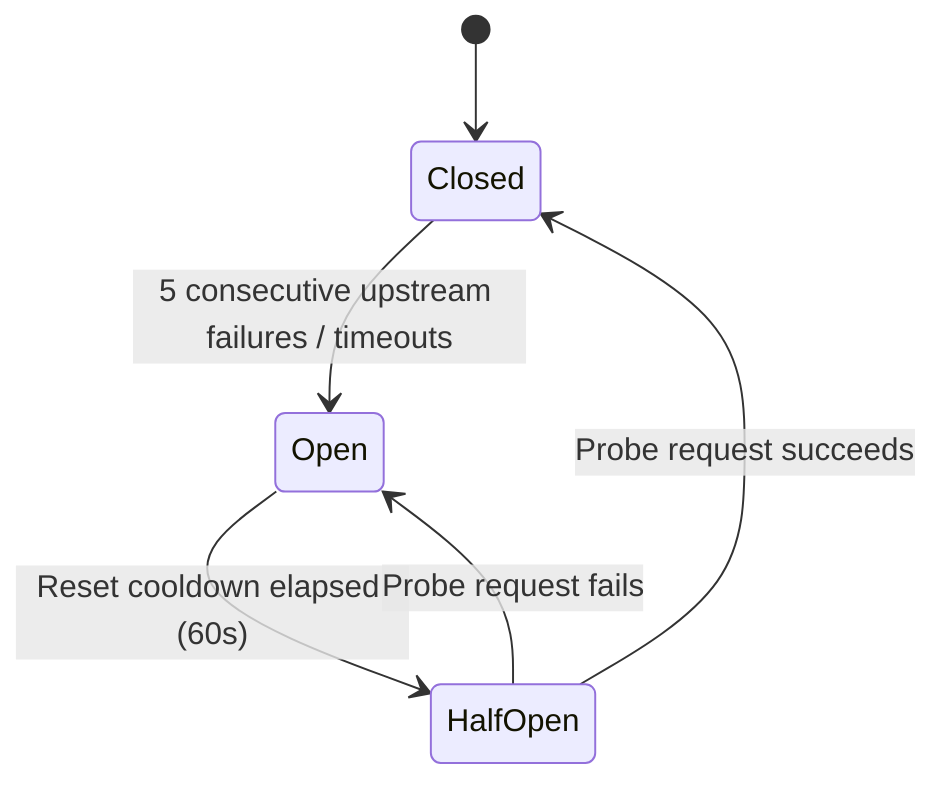

# Leeterboard System Architecture & Operations Manual

This document details the architectural design, architectural decision records (ADRs), component interactions, and operational runbooks for **Leeterboard**.

---

## 1. System Overview

Leeterboard is a competitive programming community leaderboard and progress tracking platform. It allows users to aggregate achievements across multiple competitive programming platforms (LeetCode, Codeforces, and CodinGame), engage in friendly competition, track daily solved problems, preserve streak records, and celebrate milestones.

The application is structured as a single-origin web application with:
- **Frontend**: React 19 single-page application built with Vite and Tailwind CSS.
- **Backend**: Express 5 HTTP REST API serving authentication, leaderboard calculations, and sync coordination.
- **Database**: SQLite / Turso distributed database accessed through `@libsql/client` with schema migration versioning.
- **External Integration Engine**: Direct upstream client for LeetCode GraphQL, Codeforces REST API, and CodinGame REST API.

---

## 2. Component Architecture



---

## 3. Architecture Decision Records (ADR)

### ADR-001: First-Party LeetCode Verification (Removal of Untrusted Proxies)
- **Status:** Accepted & Implemented (SEC-01)
- **Context:** Previous versions included a fallback to an external third-party proxy (`https://leetcode-stats-api.herokuapp.com`) when querying LeetCode profiles during password resets and account linking.
- **Decision:** Remove all reliance on third-party proxy endpoints. The server communicates directly with LeetCode's official GraphQL API (`https://leetcode.com/graphql`) using randomized realistic user-agent headers, timeout budgets, and strict error handling.
- **Consequences:** Eliminates Man-in-the-Middle (MITM) risks, spoofed profile responses, and unauthorized account takeovers. If LeetCode is unreachable, operations fail closed with a safe HTTP 503 error.

### ADR-002: Distributed Synchronization Leases
- **Status:** Accepted & Implemented (SEC-02)
- **Context:** Concurrent requests to scheduled cron syncs (`/api/cron/sync`) or visit-triggered stale checks could trigger race conditions, duplicate database writes, and upstream rate limiting.
- **Decision:** Implement distributed database leasing via an explicit `leases` table with atomic acquisition (`acquireLease(name, owner, ttlSeconds)`) and cooperative release (`releaseLease(name, owner)`).
- **Consequences:** Ensures exactly one synchronization worker runs at any given time across multi-instance serverless deployments (e.g. Vercel). Concurrent sync attempts immediately return HTTP 202 without blocking or erroring.

### ADR-003: Revocable User Sessions via Session Versioning
- **Status:** Accepted & Implemented (SEC-05)
- **Context:** Stateless JWT session cookies remained valid until expiration, even after password reset, account takeover triage, or explicit user sign-out from all devices.
- **Decision:** Store an incremental `session_version` integer in the `users` table. The signed JWT cookie contains `{ userId, version, ... }`. On each authenticated request, the session version in the JWT must match the database version.
- **Consequences:** Password resets, security reauths, or account events instantly increment `session_version`, instantaneously invalidating all active sessions across all devices.

### ADR-004: Upstream Circuit Breaker Pattern
- **Status:** Accepted & Implemented (SEC-11)
- **Context:** Flakiness, Cloudflare challenges, or transient outages at LeetCode's endpoint could cause cascading timeouts, exhausted database connection pools, and degraded user experience.
- **Decision:** Wrap upstream requests in a stateful Circuit Breaker (`server/circuitBreaker.ts`). Consecutive upstream failures trip the breaker from `CLOSED` to `OPEN`, immediately fast-failing downstream requests without spamming the remote endpoint.
- **Consequences:** Protects application resources and provides predictable backoff. Transitions to `HALF_OPEN` after a cooldown period to trial recovery.

### ADR-005: Dual Password Hashing (Argon2id + Scrypt)
- **Status:** Accepted & Implemented (SEC-07)
- **Context:** Secure hashing requires resistance to GPU/ASIC password cracking while maintaining seamless backward compatibility for existing user hashes.
- **Decision:** Implement Argon2id as the primary modern hashing algorithm while maintaining support for legacy scrypt hashes. Upon successful login of any account using legacy scrypt, transparently rehash the password using Argon2id and update the record.
- **Consequences:** Zero user disruption, seamless transparent upgrade path, and industry-standard password storage security.

---

## 4. Upstream LeetCode Client & Circuit Breaker Runbook

The upstream LeetCode GraphQL client is encapsulated in `server/services/leetcode.ts` and protected by `server/circuitBreaker.ts`.

### Circuit Breaker States



1. **Closed**: Normal operations. All requests pass through to LeetCode GraphQL. Failures increment an internal error counter.
2. **Open**: Error threshold reached (default 5 consecutive network/HTTP failures). The breaker rejects outgoing requests immediately, returning a fallback or `UpstreamUnavailableError` without making network calls.
3. **Half-Open**: After cooldown (default 60 seconds), one trial request is permitted to test upstream health. If successful, the breaker resets to `Closed`. If it fails, it returns to `Open` for another cooldown period.

### Incident Triage: What to do if LeetCode Upstream Fails

1. **Check Logs:** Search server structured logs for `"type":"security"` and `"event":"upstream_circuit_open"`.
2. **Verify LeetCode Status:** Check if LeetCode web or GraphQL endpoint is experiencing a global outage or Cloudflare anti-bot challenge.
3. **Inspect Circuit Breaker Status:** Query the system health endpoint:
   ```bash
   curl -s http://localhost:3000/api/health | jq .
   ```
4. **Fail-Closed Guarantees:** During an upstream outage:
   - Leaderboard reads remain operational, displaying cached stats with stale indicators.
   - Account linking and password reset via ownership verification fail closed gracefully with HTTP 503 and clear UI messaging.

---

## 5. Security & Isolation Matrix

| Layer | Implementation | Purpose |
| --- | --- | --- |
| **Authentication** | `__Host-session` cookie, SameSite=Lax, HttpOnly | Mitigates XSS cookie theft and CSRF |
| **Tamper Defense** | HMAC-SHA256 device cookie (`__Host-device`) | Defends against targeted-DoS account lockouts |
| **API Defense** | Content-Type checking, JSON parsing limits (100kb) | Prevents denial of service and prototype pollution |
| **Database** | Parameterized SQL queries via `@libsql/client` | Eliminates SQL injection vulnerabilities |
| **Frontend** | React JSX escaping, no untrusted `dangerouslySetInnerHTML` | XSS prevention |
| **Headers** | CSP with strict nonces/hashes, HSTS, X-Content-Type-Options | Defense in depth against modern browser exploits |
